# Agent4D

**Agent4D — 코딩 에이전트를 3D 공간 + 시간으로**

> 영문 README가 정본입니다(English is canonical). 이 문서는 [README.md](README.md)의 한국어 번역본이며, 내용이 다르면 영문을 따릅니다.

[](CHANGELOG.md) [](LICENSE)

[English](README.md) · **한국어**

Claude Code 에이전트가 지금 무엇을 하는지 브라우저 3D 화면으로 실시간 보여 주고, 나중에 다시 재생합니다. Agent4D 는 메인 에이전트와 서브에이전트, 워크플로 에이전트, 안에서 띄운 `claude -p` 실행, 백그라운드 셸·모니터를 하나의 살아 있는 트리로 그리는 로컬·읽기 전용 뷰어입니다. 공간 3차원에 실시간 스트리밍·재생이라는 시간 축을 더했습니다. 명령줄 도구 이름은 `agent4d` 이고, 예전 이름 `ccviz` 도 그대로 동작합니다.

[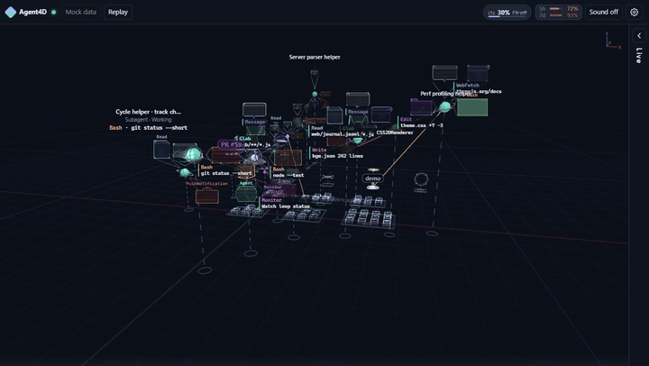](https://github.com/burn001/agent4d/releases/download/v0.1.0/agent4d-intro-v0.1.0.mp4)

▶ **[24초 소개 영상 보기(MP4)](https://github.com/burn001/agent4d/releases/download/v0.1.0/agent4d-intro-v0.1.0.mp4)**

<!-- 소개 영상(20～30초, H.264): agent4d-intro.mp4 를 GitHub 댓글·릴리스 편집 창에 끌어다 놓은 뒤, 나온 user-attachments 주소를 이 자리에 한 줄로 붙이면 플레이어로 보입니다. -->

> **비공식 프로젝트입니다.** Agent4D 는 Anthropic 이 만들거나 보증·지원하는 도구가 아닙니다. "Claude", "Claude Code" 는 Anthropic, PBC 의 상표이며, 여기서는 이 도구가 무엇과 함께 동작하는지 설명하는 데만 씁니다.

## 표현

### 흐름(Flow)

기본 표현입니다. 육각 노드, 끝이 가늘어지는 곡선 빔, 빔을 따라 흐르는 패킷.

| 움직이는 화면 | 다크 | 라이트 |
|---|---|---|
| 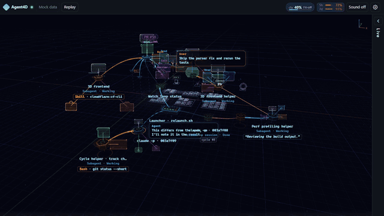 | 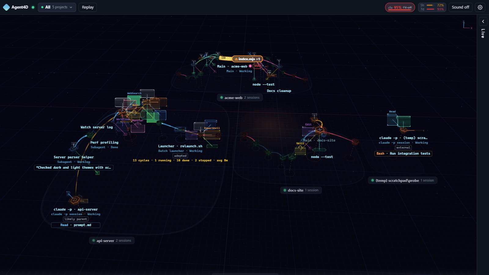 | 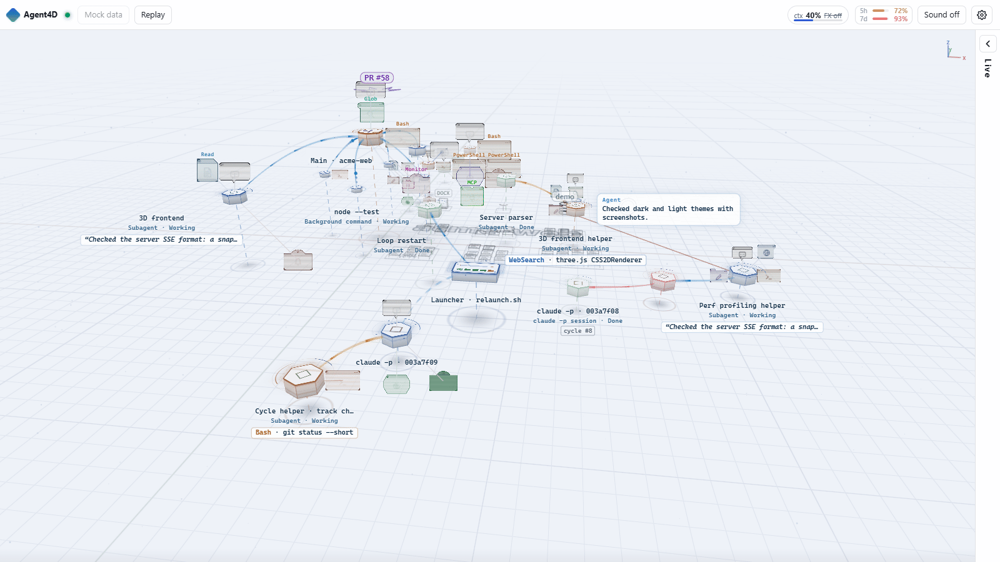 |

### Planet

메인 에이전트는 자이로 뚜르비용입니다. 면취한 스틸 브리지 케이지가 고정된 금빛 4번 휠 위를 돌고, 케이지의 이스케이프 피니언이 그 휠 위를 구르며 박마다 째깍 끊어 돌고, 기운 안쪽 케이지 속에서 밸런스 휠이 진동합니다. 서브에이전트는 더 단순한 케이지를 두른 행성이고, 프로젝트마다 둥근 궤도계로 그립니다.

| 움직이는 화면 | 다크 | 라이트 |
|---|---|---|
|  | 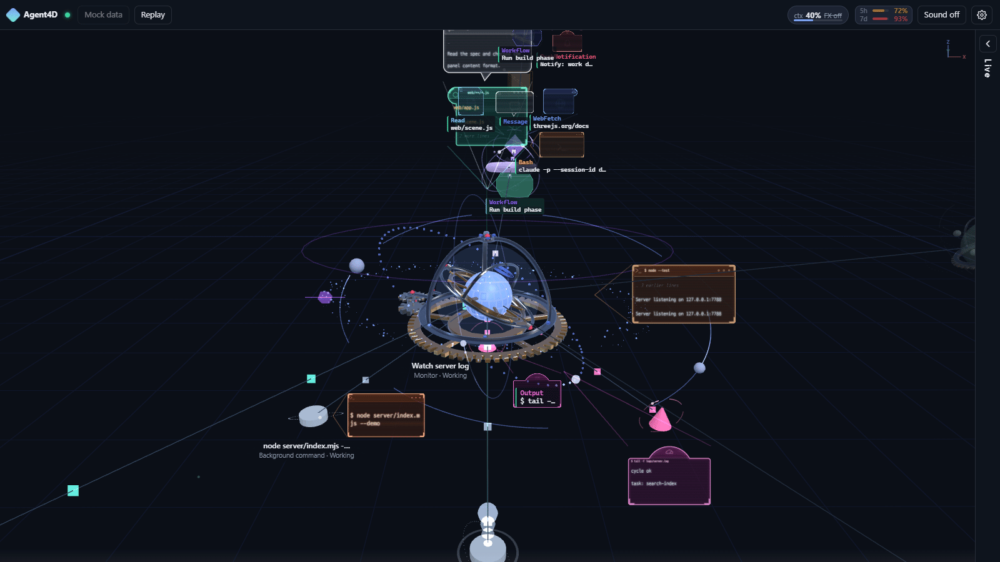 | 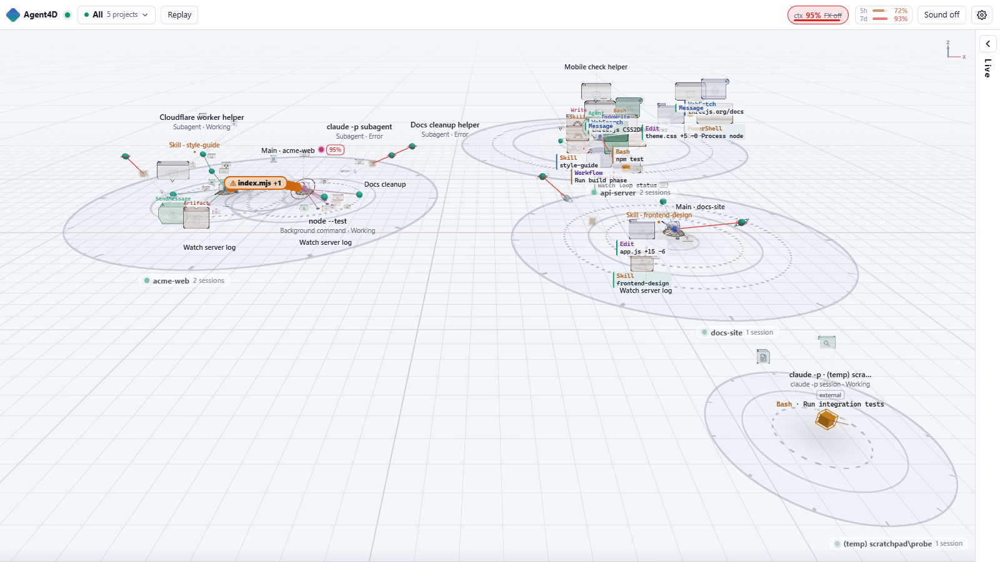 |

### 복셀 오피스

에이전트가 책상·서가·단말 앞의 사무실 직원으로 일합니다.

| 움직이는 화면 | 다크 | 라이트 |
|---|---|---|
| 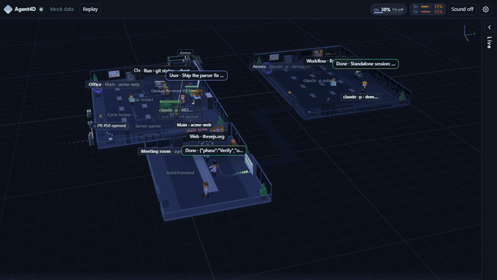 | 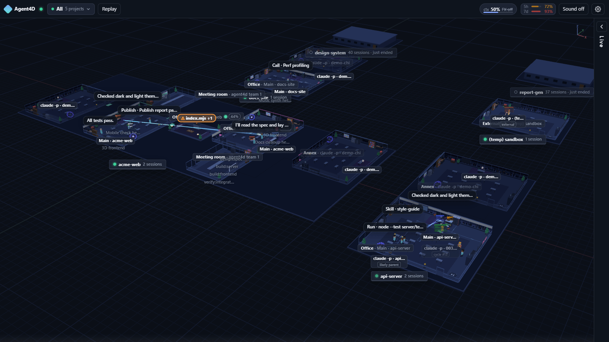 | 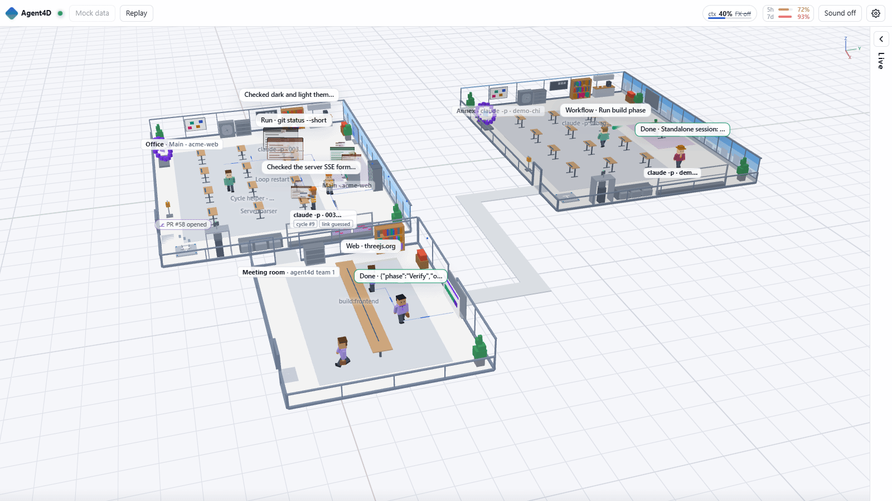 |

| 화면 테두리에 모였다 날아가는 내 프롬프트 | Planet 아래 작업 대상 층 | 저사양용 2D |
|---|---|---|
| 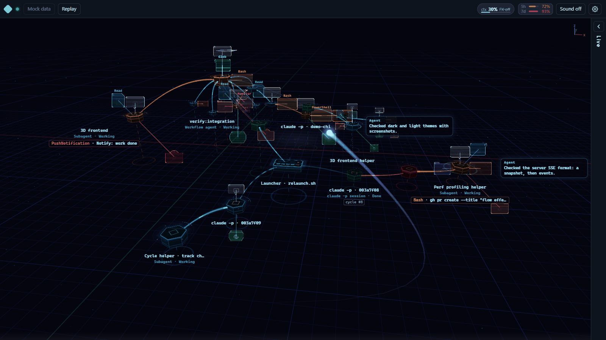 | 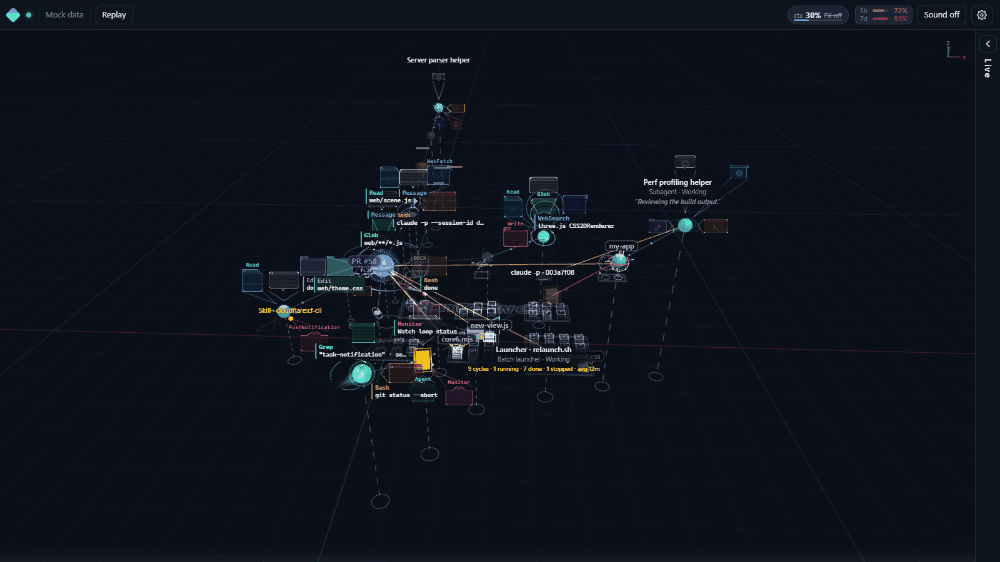 | 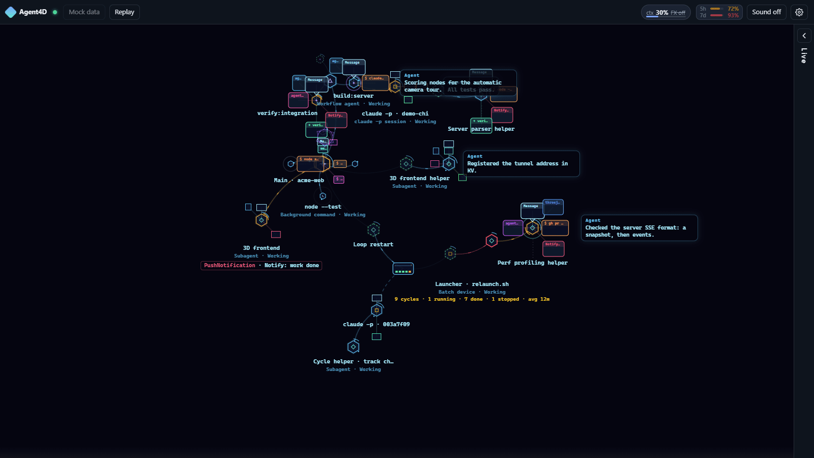 |

_스크린샷과 움직이는 화면은 모두 내장 가짜 데이터(`?mock=1&lang=en`)로 찍었습니다. 프로젝트 이름과 라벨은 지어낸 것입니다. 한국어 화면은 `lang=ko` 또는 한국어 브라우저에서 볼 수 있습니다._

## 목차

- [표현](#표현)
- [기능](#기능)
- [요구 사항](#요구-사항)
- [설치](#설치)
- [실행](#실행)
- [Claude Code 에서 쓰기(스킬)](#claude-code-에서-쓰기스킬)
- [배경음악](#배경음악)
- [원격 접속(선택)](#원격-접속선택)
- [사용 한도 게이지(옵트인)](#사용-한도-게이지옵트인)
- [보안·개인정보 주의](#보안개인정보-주의)
- [구성](#구성)
- [자주 묻는 질문·문제 해결](#자주-묻는-질문문제-해결)
- [개발](#개발)
- [크레딧](#크레딧)
- [라이선스](#라이선스)

## 기능

서버는 Claude Code 가 이미 `~/.claude/projects/` 아래에 남기는 transcript(와 백그라운드 작업 출력 파일)를 따라 읽고, 요약한 이벤트를 Server-Sent Events 로 브라우저에 보냅니다. 그 파일들에는 아무것도 쓰지 않습니다.

- **표현 세 가지.** **흐름(Flow)**(기본: 육각 노드·곡선 빔·빔을 따라 흐르는 패킷), **Planet**(메인은 기계 행성, 서브에이전트는 가스 거인·용암·얼음·고리·쌍성·혜성 등 여덟 가지 행성, 노드마다 자기 궤도와 위성이 돌고 일할 때 빨라짐, 도구 홀로그램은 궤도 링에서 투사, 프로젝트는 둥근 궤도계), **복셀 오피스**(에이전트가 책상·서가·단말로 오가는 사무실 직원). 표현마다 **3D** 와 저사양용 **2D** 가 있고, WebGL 이 없으면 2D 로 자동 전환합니다.
- **전체 또는 한 프로젝트.** 첫 화면은 이 PC 의 모든 활성 Claude Code 세션을 프로젝트마다 섬(또는 건물)으로 보여 주고, 카메라가 활동 중인 곳을 자동으로 돕니다. 사이드 패널에서 프로젝트나 세션 하나로 좁힐 수 있습니다.
- **도구 실황.** 노드 옆 패널에 지금 쓰는 도구(셸·읽기·편집·검색·웹·에이전트·스킬 등)와 한 줄 요약이 뜨고, 접는 사이드 패널에 실황 텍스트가 흐릅니다.
- **재생.** 지난 세션이나 진행 중인 세션을 처음부터 0.5～32배속으로 다시 봅니다. 쉬는 구간 압축, 타임라인 스크럽, 볼거리 표시, 연속 재생을 지원합니다. 선택 사항인 읽기 전용 **보관함** 폴더에 transcript 를 남겨 두면 원본이 지워진 뒤에도 재생할 수 있습니다(`agent4d archive add`).
- **계획 보드**(기본 끔). TodoWrite·작업 목록, 계획 모드 글, Markdown 체크리스트를 작은 판 하나로 보여 줍니다. 러너가 있으면 러너 옆, 없으면 메인 옆 월드에 고정되고, 크기는 도구 홀로그램 폭에 높이 1.5배, 기준 노드와는 선 하나로 잇습니다.
- **게이지.** 세션별 **컨텍스트 사용률** 게이지(컨텍스트가 찰수록 화면이 신호처럼 열화하는 연출은 선택)와, 옵트인 **사용 한도** 게이지(5시간·7일)가 있습니다.
- **소리**(켜기 전에는 꺼져 있음). 코드로 합성한 배경음악 12곡과, 브라우저에서 실시간 합성하는 효과음.
- **언어.** 웹 화면과 CLI 모두 기본은 영어이고, 한국어 로케일이면 한국어로 나옵니다. 둘 다 강제로 고를 수 있습니다([자주 묻는 질문](#자주-묻는-질문문제-해결) 참고).
- **원격 접속**(선택). Cloudflare quick tunnel 과 작은 Cloudflare Worker 로, 재시작해도 바뀌지 않는 토큰 보호 고정 링크를 만듭니다.

## 지원 하네스

지금은 **Claude Code** 만 읽습니다. 다른 에이전트 하네스(Codex CLI·Gemini CLI·OpenClaw·Hermes 등) 어댑터는 커뮤니티 PR 로 받습니다 — 표와 이슈 링크는 [영어 README](README.md#supported-harnesses), 구현 안내는 [docs/ADAPTERS.md](docs/ADAPTERS.md)(영어).

## 요구 사항

- **Node.js 22.18 이상.** 서버와 CLI 는 Node 내장 모듈만 쓰므로 로컬 사용에는 `npm install` 이 필요 없습니다.
- 데스크톱 브라우저. 3D 는 WebGL 이 필요하고 2D 는 없어도 됩니다.
- **Windows 에서만 검증했습니다.** POSIX 분기(프로세스 처리, `bin/agent4d` 셸 래퍼)는 있지만 macOS·Linux 는 아직 확인하지 못했습니다. `autostart` 는 Windows 전용(작업 스케줄러)입니다.
- 원격 접속을 쓸 때만: [`cloudflared`](https://developers.cloudflare.com/cloudflare-one/connections/connect-networks/downloads/), 고정 링크까지 쓰려면 Cloudflare 계정과 `cf` CLI.
- 배경음악을 직접 만들 때만: Python 3 와 `numpy`·`lameenc`(`music/requirements.txt`).

## 설치

```bash
git clone https://github.com/burn001/agent4d.git
cd agent4d
# 선택: 배경음악(아래 참고)
gh release download v0.1.0 --pattern "*.mp3" --dir web/assets
```

이것으로 끝입니다. `bin/agent4d`(sh)·`bin/agent4d.cmd`(Windows)는 `node bin/agent4d.mjs` 를 부르는 얇은 래퍼라, `bin/` 을 `PATH` 에 넣으면 `agent4d` 로 바로 쓸 수 있습니다. 예전 이름 `ccviz`(`bin/ccviz`·`bin/ccviz.cmd`·`bin/ccviz.mjs`)도 별칭으로 그대로 동작합니다.

## 실행

```bash
node bin/agent4d.mjs start      # 127.0.0.1:7788 에서 서버 시작, 로컬 링크 출력
node bin/agent4d.mjs url        # 링크 다시 출력(보기 토큰 포함)
node bin/agent4d.mjs status     # 서버·터널·Worker 상태
node bin/agent4d.mjs stop       # start 가 띄운 것 모두 종료
node bin/agent4d.mjs help       # 명령·옵션 전체
```

처음 실행하면 무작위 토큰이 든 설정 파일을 만듭니다([구성](#구성) 참고). `url` 이 출력하는 링크 끝에는 `?t=<토큰>` 이 붙습니다. 한 번 접속하면 브라우저가 쿠키를 받고 주소창에서 토큰이 사라집니다.

`start` 는 따로 요청하지 않으면 로컬에만 머뭅니다. 공개 Cloudflare 터널은 `--tunnel` 을 주거나, 설정에 `"remote": true` 또는 배포된 `workerUrl` 이 있을 때만 엽니다. `--no-tunnel` 은 언제나 로컬 전용입니다. `--watch` 를 붙이면 서버가 죽었을 때 다시 띄우는 감시 프로세스도 함께 둡니다.

**내 데이터 없이 써 보기:**

```bash
npm run demo        # 합성 세션 트리 — transcript 를 읽지 않고 네트워크도 쓰지 않음
```

그다음 `http://127.0.0.1:7788/?t=<viewToken>` 을 엽니다(토큰은 설정 파일의 `viewToken`). 서버가 떠 있으면 링크에 `&mock=1`(세션 하나) 또는 `&mock=1&scope=all`(전체 프로젝트)을 붙여 내장 가짜 데이터로 화면을 움직일 수 있고, `&view=planet`·`&view=voxel` 로 표현을 고를 수 있습니다.

## Claude Code 에서 쓰기(스킬)

레포의 `skills/agent4d/` 에 Claude Code 스킬이 들어 있습니다. 개인 스킬 폴더에 복사하면 Claude Code 에게 "open agent4d", "show my agents in 3D", "agent4d 열어줘", "agent4d 꺼줘" 같은 말로 부탁할 수 있습니다. 스킬은 설치 위치를 찾고(`AGENT4D_HOME` → `~/agent4d` → `PATH` 의 `agent4d`), 필요하면 로컬 서버를 켠 뒤 링크를 보여 줍니다. 공개 터널은 사용자가 요청할 때만 엽니다.

```bash
# 클론 안에서(macOS·Linux·Git Bash)
mkdir -p ~/.claude/skills && cp -r skills/agent4d ~/.claude/skills/
```

```powershell
# Windows PowerShell, 클론 안에서
New-Item -ItemType Directory -Force "$HOME\.claude\skills" | Out-Null
Copy-Item -Recurse -Force skills\agent4d "$HOME\.claude\skills\"
```

클론이 `~/agent4d` 가 아니면 `AGENT4D_HOME` 을 그 폴더로 지정하십시오. 복사한 뒤 Claude Code 세션을 새로 시작해야 스킬이 잡힙니다.

## 배경음악

12곡(`bgm.mp3`, `bgm-lofi.mp3`, `bgm-jazz.mp3`, `bgm-city.mp3`, `bgm-chillhop.mp3`, `bgm-dawn.mp3`, `bgm-deephouse.mp3`, `bgm-drive.mp3`, `bgm-funk.mp3`, `bgm-liquid.mp3`, `bgm-orbit.mp3`, `bgm-uplift.mp3`, 곡당 약 4.6MB)은 레포가 아니라 [v0.1.0 릴리스](https://github.com/burn001/agent4d/releases/tag/v0.1.0) 자산으로 올려 두었습니다. `web/assets/` 에 넣으면 됩니다. 없어도 화면은 그대로 동작하고 음악만 나오지 않습니다(효과음은 나옴).

```bash
# 클론 안에서 GitHub CLI 로
gh release download v0.1.0 --pattern "*.mp3" --dir web/assets

# 또는 curl 로 한 곡씩
curl -L -o web/assets/bgm-lofi.mp3 https://github.com/burn001/agent4d/releases/download/v0.1.0/bgm-lofi.mp3
```

직접 만들 수도 있습니다. 결과는 결정적이며 곡당 약 2～4분, 메모리 최대 1.5GB 가 듭니다.

```bash
python -m pip install -r music/requirements.txt
python music/compose.py                                   # web/assets/bgm.mp3
python music/compose_lofi.py --out <tmp>/bgm-lofi.mp3     # jazz, city, chillhop, dawn … 도 같은 방식
python music/tracks.py copy lofi --from <tmp>             # mp3 + json 을 web/assets/ 로 복사
```

자세한 내용은 `music/README.md` 를 보십시오.

## 원격 접속(선택)

모두 **자기 Cloudflare 계정**에서 동작합니다. 이 레포에는 공용 배포를 가리키는 값이 없습니다.

```
브라우저 ─▶ https://cc-agent-viz.<내 subdomain>.workers.dev/?t=<토큰>   (고정 링크)
             Worker: 토큰 확인 → 쿠키 → KV 에서 현재 origin 조회 → 프록시(SSE 스트리밍)
               ─▶ https://<무작위>.trycloudflare.com                   (quick tunnel, 재시작마다 바뀜)
                    ─▶ 릴레이 :7789 ─▶ 서버 :7788 (127.0.0.1)
```

1. `cloudflared` 를 설치합니다. Windows 기본 경로는 `C:/Program Files (x86)/cloudflared/cloudflared.exe` 이고, 다른 OS 는 `PATH` 에서 찾습니다. 설정의 `cloudflaredPath` 로 바꿀 수 있습니다.
2. Cloudflare `cf` CLI 를 설치하고 로그인합니다(`cf auth login`). Worker 설정은 `cloudflare/cloudflare.config.ts` 에 있고 Wrangler 파일은 쓰지 않습니다.
3. `node bin/agent4d.mjs deploy` — KV 네임스페이스를 만들거나 재사용하고, Worker(이름은 `workerName`, 기본 `cc-agent-viz`)를 배포하고, `VIEW_TOKEN`·`ADMIN_SECRET` 시크릿을 넣고, 내 `workers.dev` 주소를 설정에 저장합니다. KV 네임스페이스 ID 는 배포 때만 넘기고 레포에 쓰지 않습니다.
4. `node bin/agent4d.mjs start --tunnel --watch` — 서버·릴레이·터널을 띄우고 터널 주소를 Worker 에 등록하며, 끊기면 다시 띄우고 재등록하는 감시 프로세스를 둡니다. `deploy` 가 `workerUrl` 을 저장한 뒤에는 그냥 `start` 해도 원격으로 엽니다. 로컬에만 두려면 설정에 `"remote": false` 를 넣거나 `--no-tunnel` 을 주십시오.
5. `node bin/agent4d.mjs rotate-token` — 보기 토큰을 새로 만들고 Worker 시크릿을 바꿉니다. 예전 링크는 열리지 않습니다.

쓸 만한 옵션: `start --project <인코딩된 프로젝트 폴더>` 는 링크로 볼 수 있는 범위를 프로젝트 하나로 줄이고, `start --session <id>` 는 링크를 세션 하나에 고정합니다.

## 사용 한도 게이지(옵트인)

5시간·7일 한도 게이지는 작은 수집기가 채웁니다. 수집기는 `~/.claude/.credentials.json` 의 Claude Code OAuth 액세스 토큰으로 `https://api.anthropic.com/api/oauth/usage` 를 부릅니다. **문서화되지 않은 비공식 엔드포인트**라 언제든 바뀌거나 막힐 수 있습니다.

- 180초마다(사용률 80% 이상이면 60초) 조회하고, 결과는 60초 캐시하며, 토큰을 갱신하지 않습니다.
- 브라우저로는 사용률과 재설정 시각만 보냅니다. 토큰은 로그에 남기거나 다른 곳으로 보내지 않습니다.
- User-Agent 는 `agent4d/<버전>` 으로 밝힙니다.

**기본은 꺼져 있습니다.** 켜려면 `node bin/agent4d.mjs start --limits` 를 한 번 실행합니다. 설정에 `"limits": { "source": "oauth" }` 가 저장됩니다(이미 떠 있는 서버는 `stop` 후 `start`). 다시 끄려면 `start --no-limits`. `node bin/agent4d.mjs limits --once` 로 명령줄에서 한 번만 조회할 수도 있습니다. 판단은 각자에게 맡깁니다.

## 보안·개인정보 주의

링크를 남과 나누기 전에 꼭 읽어 주십시오.

- **화면에 세션 내용이 나옵니다.** 프롬프트, 어시스턴트 메시지, 파일 경로, 셸 명령과 출력이 (요약·잘림을 거쳐도) 실제 내용 그대로 보입니다. 유효한 링크를 가진 사람은 누구나 볼 수 있습니다.
- **잠금은 토큰 하나뿐입니다.** 모든 요청에 보기 토큰(쿼리 `t`, 쿠키, `X-CCVIZ-Token` 헤더)이 필요하며 localhost 도 예외가 없습니다. `?t=` 가 든 링크는 비밀번호처럼 다루고 대화방·이슈·스크린샷에 붙이지 마십시오. 새어 나갔다면 `rotate-token` 을 실행하십시오.
- **기본으로 모든 프로젝트가 보입니다.** `project`(또는 `start --project`)를 정하지 않으면 토큰을 가진 사람이 이 PC 의 모든 Claude Code 세션을 고를 수 있습니다. 남에게 링크를 줄 때는 먼저 프로젝트 하나로 제한하십시오.
- **기본은 로컬 전용입니다.** 서버는 `127.0.0.1` 에만 바인드합니다. 인터넷 노출은 직접 켜는 선택 기능(터널·Worker: `--tunnel`, `"remote": true`, 배포된 Worker)으로만 일어납니다.
- **읽기 전용입니다.** 서버는 transcript 와 작업 출력을 읽기만 합니다. 보관함 기능은 내가 고른 보관 폴더에만, `agent4d archive add` 를 실행할 때만 씁니다.
- **마스킹은 최선의 노력입니다.** 모든 글은 `server/redact.mjs` 를 거쳐 API 키·Bearer 토큰·JWT·PEM·URL 속 자격 증명·`password=` 꼴·이메일·전화·주민번호 꼴·긴 무작위 문자열을 가립니다. thinking 내용과 도구 입력 전문은 보내지 않습니다. `"privacy": "minimal"` 이면 더 적게 보냅니다. 그래도 모든 것을 잡지는 못하니 민감한 작업에는 기대지 마십시오.
- **토큰은 로그 파일에 남지 않습니다.** 토큰이 든 링크는 콘솔에만 출력합니다.

## 구성

상태와 비밀은 레포 밖 `~/.cc-agent-viz/` 에 둡니다(폴더 이름은 당분간 예전 이름을 유지합니다). 예전 버전을 써서 `~/.cc-session-viz/` 가 이미 있으면 그 폴더를 계속 씁니다. 다른 폴더를 쓰려면 `CCVIZ_HOME` 을 정하십시오. OS 가 허용하면 소유자만 읽고 쓸 수 있게 만듭니다.

| 파일 | 내용 |
|---|---|
| `config.json` | `viewToken`, `adminSecret`, `port`(7788), `privacy`(`summary`/`minimal`), `project`, `linkSession`, `remote`(`true`/`false`, 없으면 `workerUrl` 이 있을 때만 원격), `cloudflaredPath`, `tunnelProtocol`(`http2`), `workerName`(`cc-agent-viz`), `workerUrl`, `kvNamespaceId`, `limits{ source: off(기본)/oauth/auto/statusline, … }`, `overviewMaxRoots`, `archiveDir`, `serviceScripts` |
| `usage-cache.json` | 마지막 사용 한도 값(사용률·재설정 시각만) |
| `state.json` | 서버·릴레이·터널·감시 프로세스 ID, 현재 터널 주소 |
| `logs/` | `server.log`, `relay.log`, `cloudflared.log`, `watch.log` |

Claude Code 데이터는 `~/.claude`(또는 `CLAUDE_CONFIG_DIR`)에서 읽습니다. 보관함 폴더는 `archiveDir`, `CCVIZ_ARCHIVE`, `--dir` 로 정하며 기본값은 없습니다.

`serviceScripts` 는 '작업 대상' 층에서 내 보조 스크립트를 외부 서비스로 표시하게 합니다. 예: `[{ "pattern": "my-mail-cli\\.mjs", "name": "Mail" }]`(`node`·`python`·`bash` 인자에 대소문자 무시 정규식으로 맞춤). 잘 알려진 CLI(`gws`, `aws`, `gcloud`, `cf`, `docker` 등)는 설정 없이 알아봅니다.

## 자주 묻는 질문·문제 해결

**화면이 비어 있거나 세션을 기다린다고 나옵니다.**
Claude Code 가 `~/.claude/projects/` 에 기록한 세션만 보입니다. Claude Code 세션을 시작하거나 이어 가면 몇 초 안에 나타납니다. Claude Code 데이터가 다른 곳에 있으면 `start` 전에 `CLAUDE_CONFIG_DIR` 을 정하십시오.

**"401" 또는 "unauthorized" 가 나옵니다.**
링크에 보기 토큰이 있어야 합니다. `node bin/agent4d.mjs url` 로 받은 링크를 한 번 열면 브라우저가 쿠키를 받습니다. `rotate-token` 뒤에는 예전 링크와 쿠키가 모두 막힙니다.

**7788 포트를 이미 쓰고 있습니다.**
`start --port 7790` 처럼 바꾸거나 설정의 `port` 를 고치십시오. `status` 는 `agent4d` 가 띄운 것을, `stop` 은 그것을 끕니다.

**3D 가 비거나 검거나 아주 느립니다.**
상단 바의 3D/2D 단추로 2D 로 바꾸십시오(링크에 `&dim=2d` 를 붙여도 됨). three.js 는 jsDelivr CDN 에서 받으므로 CDN 이 막힌 망에서는 2D 만 동작합니다.

**음악이 나오지 않습니다.**
MP3 파일은 레포에 없습니다. [배경음악](#배경음악)을 보십시오. 또 브라우저는 페이지를 한 번 누르기 전까지 소리를 막으니, 소리를 켠 뒤 화면을 한 번 눌러 주십시오.

**사용 한도 게이지가 비어 있습니다.**
기본은 꺼져 있습니다. `start --limits` 로 켜고, Claude Code 에 구독 계정으로 로그인했는지 확인하십시오(수집기는 `~/.claude/.credentials.json` 을 읽음). 비공식 엔드포인트라 동작하지 않을 수도 있습니다.

**언어를 바꾸려면?**
웹 화면: ⚙ 설정 메뉴의 언어 줄, 또는 링크에 `?lang=en`·`?lang=ko`. CLI: `--lang en|ko` 또는 환경 변수 `CCVIZ_LANG`. 없으면 `LC_ALL`·`LC_MESSAGES`·`LANG`, 그다음 시스템 로케일로 정하고 마지막 기본은 영어입니다.

**내 데이터를 어딘가로 보내나요?**
기본 로컬 모드에서는 보내지 않습니다. 선택 기능인 원격 모드만 내 Cloudflare 터널·Worker 를 거쳐 화면 스트림을 보내고, 옵트인 사용 한도 수집기만 (내 사용량을 읽으려고) Anthropic API 를 부릅니다.

**Claude Code 와 같이 돌려도 안전한가요?**
네. Claude Code 가 쓰는 파일을 읽기만 하고 고치지 않으며, Claude Code 프로세스와 통신하지 않습니다.

## 개발

```bash
npm test            # server/·web/ 의 node --test
```

코드 주석은 대부분 한국어입니다. 버그 제보와 풀 리퀘스트를 환영합니다. OS·Node 버전·브라우저를 적어 주시고, `?t=` 가 든 링크는 절대 붙이지 마십시오.

## 크레딧

- **흐름(Flow)** 표현의 시각 언어(짙은 남색 공간, 육각 노드, 끝이 가는 곡선 빔, 혜성 같은 패킷, 말풍선)는 [patoles/agent-flow](https://github.com/patoles/agent-flow)(Apache-2.0)를 참고했습니다. 이 프로젝트와 관계는 없습니다.
- [three.js](https://threejs.org/) r170(MIT) — 실행 시 jsDelivr CDN 에서 Subresource Integrity 해시와 함께 받습니다. 2D 모드는 받지 않습니다.
- 배경음악은 `music/` 의 스크립트가 [numpy](https://numpy.org/) 로 합성하고 [lameenc](https://github.com/chrisstaite/lameenc) 로 인코딩합니다. 세 곡(lofi·jazz·city)은 작성자의 이전 프로젝트에서 가져온 편곡이고 나머지는 새로 만든 곡입니다.
- 원격 접속은 [Cloudflare Tunnel](https://developers.cloudflare.com/cloudflare-one/connections/connect-networks/)(`cloudflared`)과 [Cloudflare Workers](https://workers.cloudflare.com/)·KV 를 씁니다.

## 라이선스

[Apache License 2.0](LICENSE) © 2026 burn001 (Dr. Cho, Sangkyu). See [NOTICE](NOTICE). Uses [three.js](https://threejs.org) (MIT).
