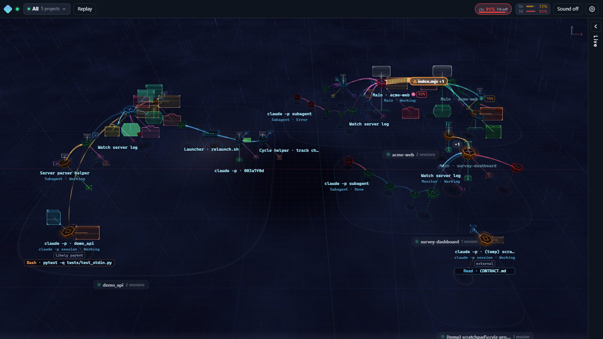
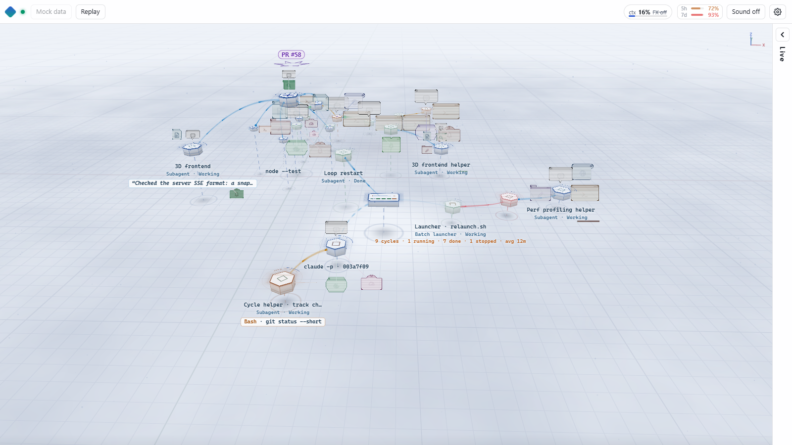
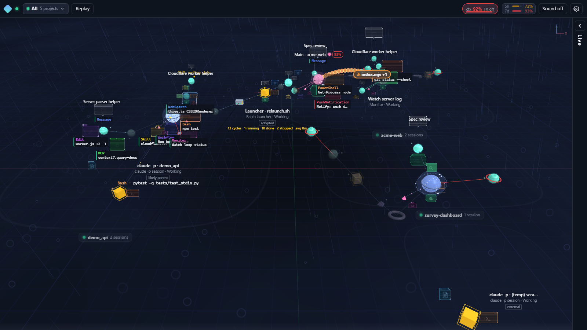
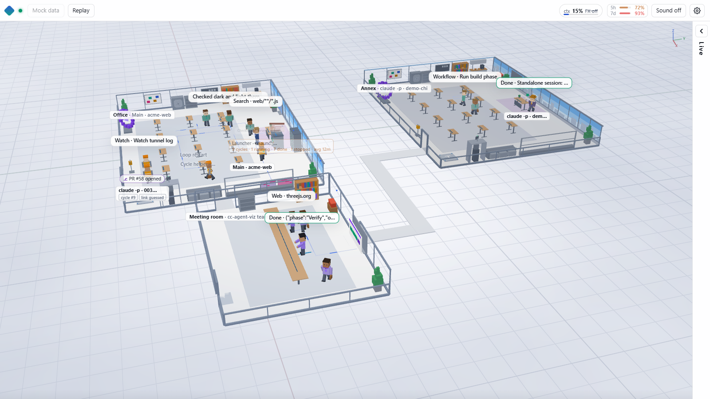
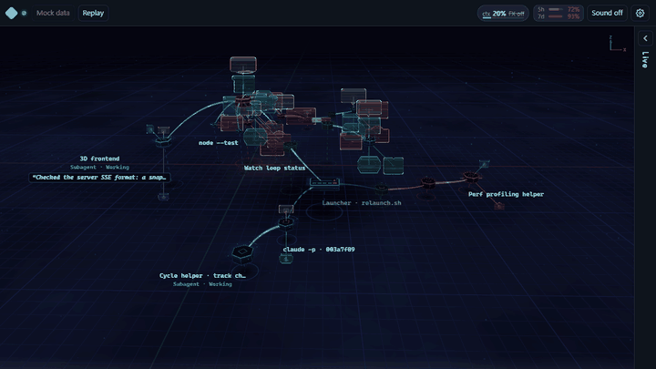

# cc-agent-viz

**English** · [한국어](README.ko.md)

See what your Claude Code agents are doing, live, in 3D. cc-agent-viz is a local, read-only viewer that turns the main agent, its subagents, workflow agents, nested `claude -p` runs, background shells and monitors into one live tree in your browser. The command-line tool is called `ccviz`.

> **Unofficial project.** cc-agent-viz is an independent tool. Anthropic did not make it, does not endorse it and does not support it. "Claude" and "Claude Code" are trademarks of Anthropic, PBC, used here only to say what this tool works with.



| One session, Flow, light theme | All projects, Planet | One session, Voxel Office |
|---|---|---|
|  |  |  |



_All screenshots use the built-in mock data (`?mock=1&lang=en`). Project names and labels are made up._

## Contents

- [Features](#features)
- [Requirements](#requirements)
- [Install](#install)
- [Run](#run)
- [Background music](#background-music)
- [Remote access (optional)](#remote-access-optional)
- [Usage-limit gauge (opt-in)](#usage-limit-gauge-opt-in)
- [Security and privacy](#security-and-privacy)
- [Configuration](#configuration)
- [FAQ and troubleshooting](#faq-and-troubleshooting)
- [Development](#development)
- [Credits](#credits)
- [License](#license)

## Features

The server tails the transcripts that Claude Code already writes under `~/.claude/projects/` (and background task output files) and streams a summarized event feed to the browser over Server-Sent Events. It never writes to those files.

- **Three views.** **Flow** (default: hexagon nodes, curved beams, packets moving along them), **Planet**, and **Voxel Office** (agents as office workers at desks, shelves and terminals). Each view has a **3D** mode and a lighter **2D** mode for slow machines. 2D is picked automatically when WebGL is missing.
- **All projects, or just one.** The start screen shows every active Claude Code session on this machine, one island (or building) per project, with an automatic camera tour. Narrow it to one project or one session from the side panel.
- **Live tool activity.** Panels next to each node show the current tool (shell, read, edit, search, web, agent, skill…) and a one-line summary. A collapsible side panel shows a live text feed.
- **Replay.** Play past or running sessions from the start at 0.5×–32×, with idle gaps compressed, a scrubbable timeline, highlight markers and continuous playback. An optional read-only **archive** folder keeps transcripts around for replay after the originals are gone (`ccviz archive add`).
- **Plan board** (off by default). TodoWrite and task lists, plan-mode text and Markdown checklists appear as small boards next to the agent that owns them.
- **Gauges.** A per-session **context usage** gauge, with an optional "signal degradation" effect (grain, scanlines, glitches) as the context fills up, and an opt-in **usage-limit** gauge for the 5-hour and 7-day windows.
- **Sound** (off until you turn it on). 12 background tracks synthesized from code, plus sound effects synthesized live in the browser.
- **Languages.** The web UI and the CLI are in English by default and switch to Korean on a Korean locale. Both can be forced (see [FAQ](#faq-and-troubleshooting)).
- **Remote access** (optional). A Cloudflare quick tunnel plus a small Cloudflare Worker give you a stable, token-protected link that survives restarts.

## Requirements

- **Node.js 22.18 or newer.** The server and CLI use only Node built-in modules, so there is nothing to `npm install` for local use.
- A desktop browser. 3D needs WebGL; 2D works without it.
- **Tested on Windows only.** The code has POSIX branches (process handling, the `bin/ccviz` shell wrapper), but macOS and Linux have not been tested yet. `autostart` is Windows-only (Task Scheduler).
- For remote access only: [`cloudflared`](https://developers.cloudflare.com/cloudflare-one/connections/connect-networks/downloads/), and for the stable link a Cloudflare account with the `cf` CLI.
- To regenerate the music only: Python 3 with `numpy` and `lameenc` (`music/requirements.txt`).

## Install

```bash
git clone https://github.com/burn001/cc-agent-viz.git
cd cc-agent-viz
# optional: background music (see below)
gh release download v0.1.0 --pattern "*.mp3" --dir web/assets
```

That is all. `bin/ccviz` (sh) and `bin/ccviz.cmd` (Windows) are thin wrappers around `node bin/ccviz.mjs`; put `bin/` on your `PATH` if you want to type `ccviz`.

## Run

```bash
node bin/ccviz.mjs start      # start the server on 127.0.0.1:7788 and print the local link
node bin/ccviz.mjs url        # print the link again (it contains your view token)
node bin/ccviz.mjs status     # server / tunnel / Worker status
node bin/ccviz.mjs stop       # stop everything `start` launched
node bin/ccviz.mjs help       # all commands and options
```

The first run creates a config file with random tokens (see [Configuration](#configuration)). The link from `url` ends in `?t=<token>`. After the first visit the browser keeps a cookie and the token is removed from the address bar.

`start` stays local unless you ask otherwise. It opens a public Cloudflare tunnel only with `--tunnel`, or when the config has `"remote": true` or a deployed `workerUrl`. `--no-tunnel` always forces local-only. Add `--watch` to keep a small watchdog that restarts the server if it dies.

**Try it without your own data:**

```bash
npm run demo        # synthetic session tree: reads no transcripts, makes no network calls
```

Then open `http://127.0.0.1:7788/?t=<viewToken>` (the token is `viewToken` in the config file). On a running server you can also add `&mock=1` (one session) or `&mock=1&scope=all` (all projects) to the link to drive the UI from built-in mock data, and `&view=planet` or `&view=voxel` to pick a view.

## Background music

The 12 tracks (`bgm.mp3`, `bgm-lofi.mp3`, `bgm-jazz.mp3`, `bgm-city.mp3`, `bgm-chillhop.mp3`, `bgm-dawn.mp3`, `bgm-deephouse.mp3`, `bgm-drive.mp3`, `bgm-funk.mp3`, `bgm-liquid.mp3`, `bgm-orbit.mp3`, `bgm-uplift.mp3`; about 4.6 MB each) are attached to the [v0.1.0 release](https://github.com/burn001/cc-agent-viz/releases/tag/v0.1.0) rather than stored in the repository. Put them in `web/assets/`. Without them the viewer works fine, just without music (sound effects still play).

```bash
# with the GitHub CLI, inside the clone
gh release download v0.1.0 --pattern "*.mp3" --dir web/assets

# or with curl, one file at a time
curl -L -o web/assets/bgm-lofi.mp3 https://github.com/burn001/cc-agent-viz/releases/download/v0.1.0/bgm-lofi.mp3
```

You can also generate them yourself. Output is deterministic; each track takes about 2–4 minutes and up to 1.5 GB of RAM.

```bash
python -m pip install -r music/requirements.txt
python music/compose.py                                   # web/assets/bgm.mp3
python music/compose_lofi.py --out <tmp>/bgm-lofi.mp3     # likewise jazz, city, chillhop, dawn, …
python music/tracks.py copy lofi --from <tmp>             # copy mp3 + json into web/assets/
```

`music/README.md` (in Korean) has the details.

## Remote access (optional)

Everything here runs on **your own Cloudflare account**. Nothing in this repository points at a shared deployment.

```
browser ─▶ https://cc-agent-viz.<your-subdomain>.workers.dev/?t=<token>   (stable link)
             Worker: check token → cookie → look up the current origin in KV → proxy (SSE streaming)
               ─▶ https://<random>.trycloudflare.com                     (quick tunnel, changes on restart)
                    ─▶ relay :7789 ─▶ server :7788 (127.0.0.1)
```

1. Install `cloudflared`. On Windows the default path is `C:/Program Files (x86)/cloudflared/cloudflared.exe`; elsewhere it is looked up on `PATH`. You can set `cloudflaredPath` in the config.
2. Install the Cloudflare `cf` CLI and sign in (`cf auth login`). The Worker is configured in `cloudflare/cloudflare.config.ts`; no Wrangler file is used.
3. `node bin/ccviz.mjs deploy` creates or reuses a KV namespace, deploys the Worker (named `cc-agent-viz` unless you change `workerName`), sets the `VIEW_TOKEN` and `ADMIN_SECRET` secrets, and saves your `workers.dev` URL in the config. The KV namespace ID is passed at deploy time and never written to the repository.
4. `node bin/ccviz.mjs start --tunnel --watch` starts the server, relay and tunnel, registers the tunnel address with the Worker, and keeps a watchdog that restarts and re-registers on failure. Once `deploy` has saved a `workerUrl`, a plain `start` also goes remote; set `"remote": false` in the config (or pass `--no-tunnel`) to stay local.
5. `node bin/ccviz.mjs rotate-token` issues a new view token and updates the Worker secret. Old links stop working.

Useful options: `start --project <encoded-project-dir>` limits what the link can see to one project; `start --session <id>` pins the link to one session.

## Usage-limit gauge (opt-in)

The 5-hour / 7-day gauge is filled by a small collector that reads the Claude Code OAuth access token from `~/.claude/.credentials.json` and calls `https://api.anthropic.com/api/oauth/usage`. **This endpoint is undocumented and unofficial** and may change or stop working at any time.

- The collector polls every 180 s (60 s above 80 % usage), caches results for 60 s and never refreshes tokens.
- Only percentages and reset times reach the browser. The token is never logged or forwarded.
- It identifies itself with the User-Agent `cc-agent-viz/<version>`.

It is **off by default**. To turn it on, run `node bin/ccviz.mjs start --limits` once; this saves `"limits": { "source": "oauth" }` in the config (restart a running server with `stop`, then `start`). `start --no-limits` turns it off again. `node bin/ccviz.mjs limits --once` queries it once from the command line. Use it at your own discretion.

## Security and privacy

Read this before you share any link.

- **The viewer shows your session content.** Prompts, assistant messages, file paths, shell commands and their output appear on screen. They are summarized and truncated, but they are real. Anyone with a valid link can see them.
- **The token is the only lock.** Every request needs the view token (query `t`, cookie, or `X-CCVIZ-Token` header). There is no localhost exemption. Treat a link with `?t=` like a password: keep it out of chats, tickets and screenshots. If it leaks, run `rotate-token`.
- **All projects are visible by default.** Unless `project` is set (or `start --project`), a token holder can browse every Claude Code session on the machine. Limit it to one project before giving a link to anyone else.
- **Local only by default.** The server binds to `127.0.0.1`. It is reachable from the internet only through the optional tunnel and Worker, which you turn on yourself (`--tunnel`, `"remote": true`, or a deployed Worker).
- **Read-only.** The server only reads transcripts and task output. The archive feature writes only to the archive folder you choose, and only when you run `ccviz archive add`.
- **Redaction is best-effort.** All text passes through `server/redact.mjs`, which masks API keys, bearer tokens, JWTs, PEM blocks, credentials in URLs, `password=`-style pairs, emails, phone and ID numbers, and long opaque strings. Thinking content and full tool inputs are never sent. `"privacy": "minimal"` sends even less. Redaction cannot catch everything, so don't rely on it for sensitive work.
- **Tokens stay out of log files.** The CLI prints the tokenized link to the console only.

## Configuration

State and secrets live outside the repository, in `~/.cc-agent-viz/`. If you used an earlier version and `~/.cc-session-viz/` exists, that folder keeps being used. Set `CCVIZ_HOME` to use any other folder. Files are created with owner-only permissions where the OS allows it.

| File | Contents |
|---|---|
| `config.json` | `viewToken`, `adminSecret`, `port` (7788), `privacy` (`summary` / `minimal`), `project`, `linkSession`, `remote` (`true` / `false`; unset = remote only if `workerUrl` is set), `cloudflaredPath`, `tunnelProtocol` (`http2`), `workerName` (`cc-agent-viz`), `workerUrl`, `kvNamespaceId`, `limits { source: off (default) / oauth / auto / statusline, … }`, `overviewMaxRoots`, `archiveDir`, `serviceScripts` |
| `usage-cache.json` | last usage-limit values (percentages and reset times only) |
| `state.json` | process IDs of the server, relay, tunnel and watchdog; current tunnel URL |
| `logs/` | `server.log`, `relay.log`, `cloudflared.log`, `watch.log` |

Claude Code data is read from `~/.claude` (or `CLAUDE_CONFIG_DIR`). The archive folder is set with `archiveDir`, `CCVIZ_ARCHIVE` or `--dir`; there is no default.

`serviceScripts` lets the "work targets" layer label your own helper scripts as external services, for example `[{ "pattern": "my-mail-cli\\.mjs", "name": "Mail" }]` (a case-insensitive regex matched against the arguments of `node`, `python` or `bash`). Well-known CLIs (`gws`, `aws`, `gcloud`, `cf`, `docker`, …) are recognized without it.

## FAQ and troubleshooting

**The page is empty or says it is waiting for sessions.**
The viewer only shows sessions that Claude Code has written to `~/.claude/projects/`. Start or continue a Claude Code session and it appears within a few seconds. If your Claude Code data lives elsewhere, set `CLAUDE_CONFIG_DIR` before `start`.

**I get "401" or "unauthorized".**
The link needs the view token. Run `node bin/ccviz.mjs url` and open that link once; the browser then keeps a cookie. After `rotate-token`, old links and cookies stop working.

**Port 7788 is already in use.**
Use `start --port 7790` (or set `port` in the config). `status` shows what `ccviz` itself is running; `stop` stops it.

**3D is blank, black or very slow.**
Switch to 2D with the 3D/2D button in the top bar (or add `&dim=2d` to the link). three.js is loaded from the jsDelivr CDN; on networks that block it, only 2D works.

**No music.**
The MP3 files are not in the repository; see [Background music](#background-music). Browsers also block audio until you interact with the page, so click once after turning sound on.

**The usage-limit gauge shows nothing.**
It is off by default. Turn it on with `start --limits`, and make sure you are signed in to Claude Code with a subscription account (the collector reads `~/.claude/.credentials.json`). The endpoint is unofficial and may stop working.

**How do I change the language?**
Web UI: the language row in the ⚙ settings menu, or `?lang=en` / `?lang=ko` in the link. CLI: `--lang en|ko` or the `CCVIZ_LANG` environment variable; otherwise `LC_ALL`, `LC_MESSAGES`, `LANG` and then the system locale decide, with English as the fallback.

**Does it send my data anywhere?**
Not in the default local mode. Only the optional remote mode sends the viewer stream through your own Cloudflare tunnel and Worker, and only the opt-in usage-limit collector talks to Anthropic's API (to read your own usage).

**Is it safe to run next to Claude Code?**
Yes. It only reads files that Claude Code writes, never modifies them, and does not talk to the Claude Code process.

## Development

```bash
npm test            # node --test for server/ and web/
```

Most code comments are in Korean. Bug reports and pull requests are welcome; please include your OS, Node version and browser, and never paste a link that contains `?t=`.

## Credits

- The **Flow** view's visual language (deep navy space, hexagon nodes, tapered curved beams, comet-like packets, speech bubbles) is inspired by [patoles/agent-flow](https://github.com/patoles/agent-flow) (Apache-2.0). This project is not affiliated with it.
- [three.js](https://threejs.org/) r170 (MIT), loaded at runtime from the jsDelivr CDN with Subresource Integrity hashes. The 2D mode does not load it.
- Background music is generated by the scripts in `music/` with [numpy](https://numpy.org/) and encoded with [lameenc](https://github.com/chrisstaite/lameenc). Three tracks (lofi, jazz, city) are arrangements derived from the author's earlier project; the rest are original.
- Remote access uses [Cloudflare Tunnel](https://developers.cloudflare.com/cloudflare-one/connections/connect-networks/) (`cloudflared`) and [Cloudflare Workers](https://workers.cloudflare.com/) with KV.

## License

[MIT](LICENSE) © 2026 cc-agent-viz contributors.
